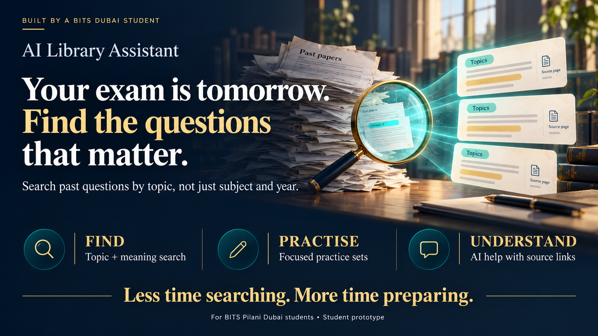
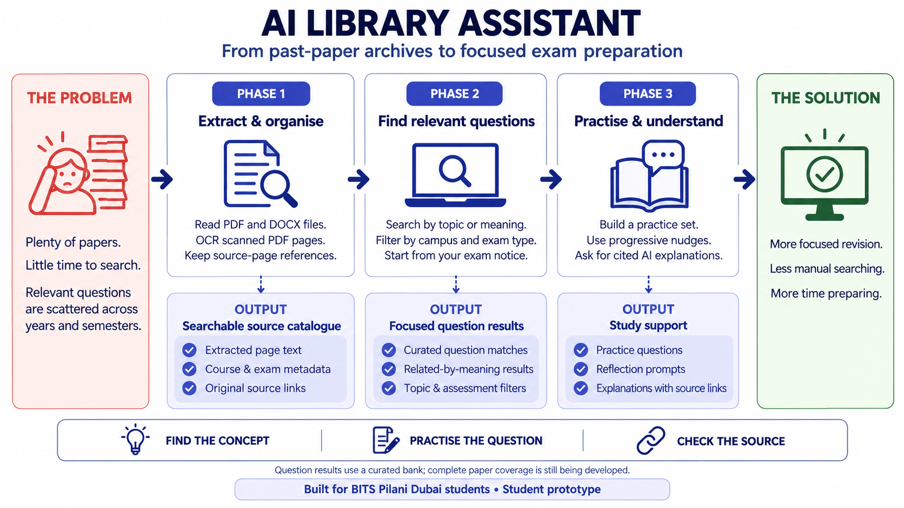
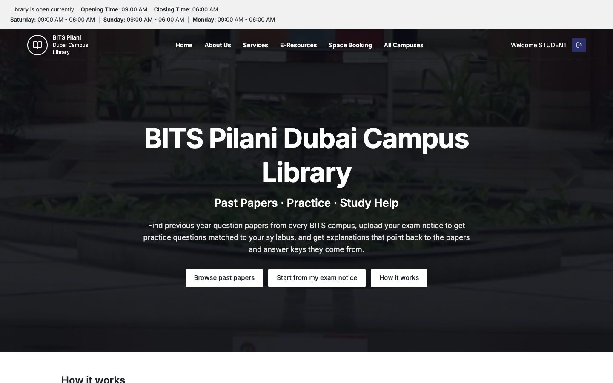
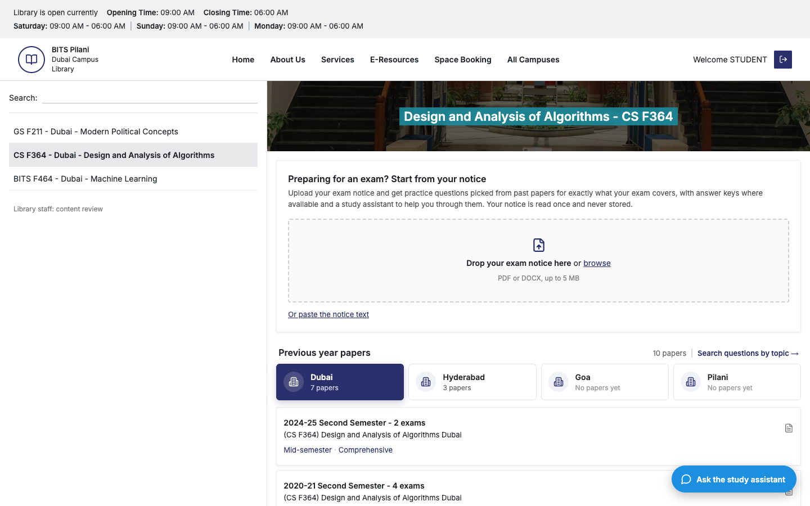
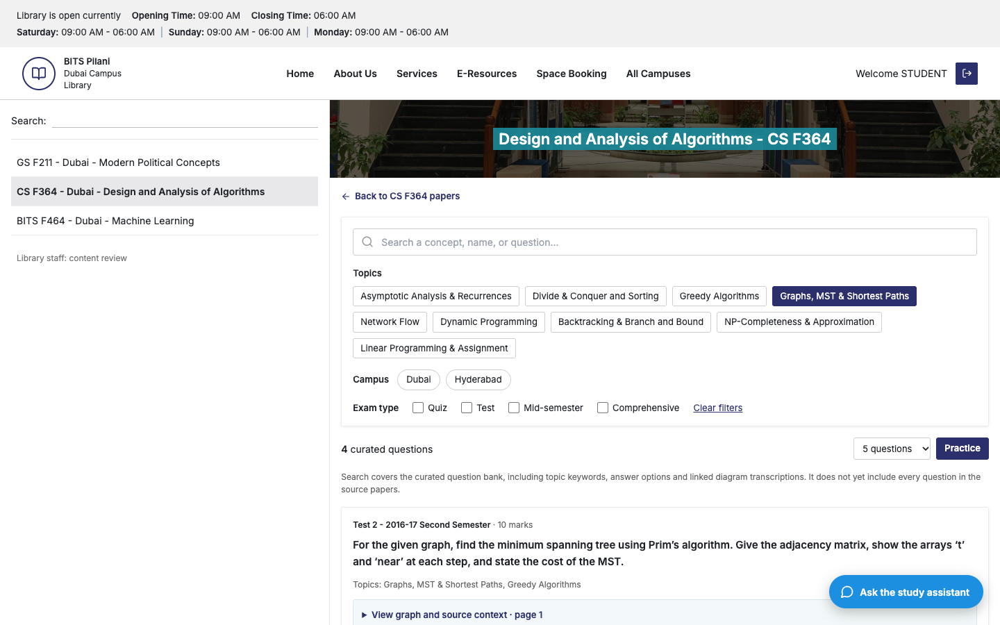
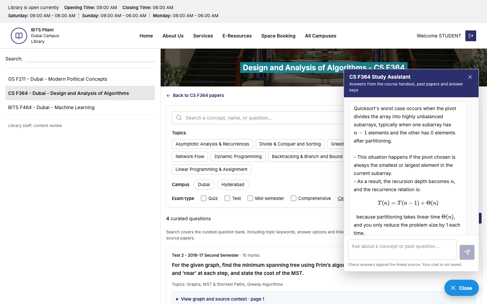
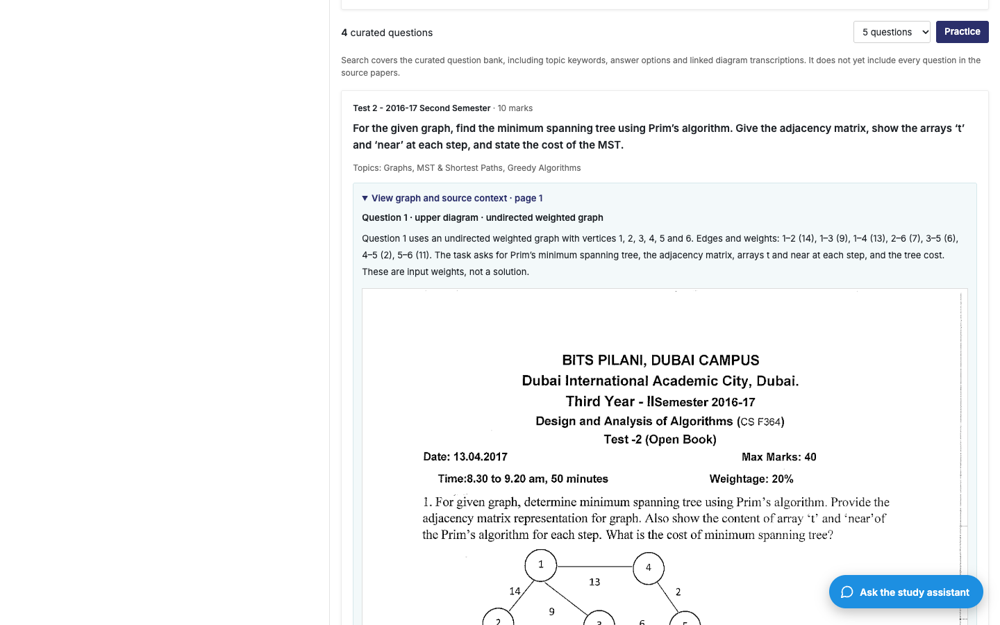
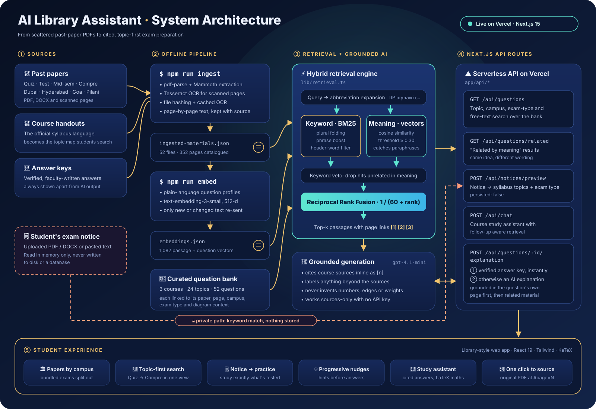
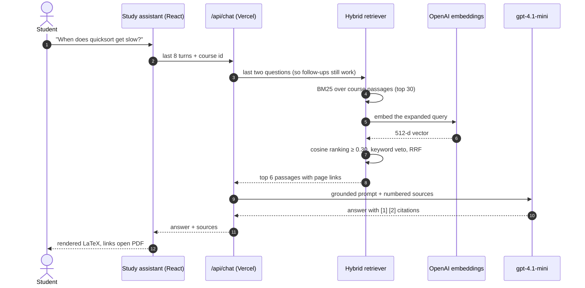

<div align="center">



# 📚 AI Library Assistant

### Search past papers by *topic*, not by year. Practise with hints. Get answers that cite the page they came from.

**Built for BITS Pilani students, starting with the Dubai Campus library.**

<br/>

[](https://ai-library-assistant-ten.vercel.app)

<br/>


[**Try it live**](https://ai-library-assistant-ten.vercel.app) · [**60-second judge tour**](#-60-second-tour-for-judges) · [**Architecture**](#-architecture) · [**Run locally**](#-run-it-locally)

</div>

---

## 🎯 The problem

It's the night before the mid-sem. Your exam notice lists *"Prim's, Dijkstra, Network Flow."* The library gives you past papers as **year-labelled PDFs**: one per semester, from four campuses, some scanned, some bundling five exams in one file.

So you open them one by one, scroll, squint, and hope you didn't miss the one question that matters.

> **Every student asks the same questions:** *Which past questions cover this topic? Has it come up in a quiz, or only in the compre? What should I actually practise for this notice?* The PDFs can't answer any of them.

## 💡 Our solution

**AI Library Assistant turns a pile of past papers, handouts, answer keys and exam notices into a topic-first study tool.**

| | You do this | You get this |
|---|---|---|
| 🔎 | Pick a syllabus topic, or type a concept in your own words | Every matching past question across **Quiz, Test, Mid-sem and Compre**, from **all four campuses** |
| 🗒️ | Upload your exam notice | Suggested syllabus topics plus a matching practice set. **The notice is never stored.** |
| 💡 | Get stuck on a question | **Progressive nudges** that guide your thinking without giving the answer away |
| ✅ | Reveal the answer | The **verified answer key** when one exists, or an AI explanation **clearly labelled** and **cited to the source pages** |
| 💬 | Ask the study assistant anything | Answers grounded in *your course's* papers, with `[1] [2]` citations that open the original PDF at the exact page |

<div align="center">

</div>

---

## 🏆 Why this stands out

<table>
<tr>
<td width="50%" valign="top">

### 🧠 Real hybrid retrieval, not a chatbot wrapper
Keyword search (**BM25**) and meaning search (**OpenAI embeddings**) run side by side and are merged with **Reciprocal Rank Fusion**. Ask *"when does quicksort get slow?"* and it still finds the paper that says *"worst-case pivot."* A keyword veto removes hits that share only incidental words.

</td>
<td width="50%" valign="top">

### 📎 Every answer is traceable
Citations like `[2]` link straight to `paper.pdf#page=7`. Verified answer keys are kept apart from AI text. When the model goes beyond the sources, it has to start with *"General explanation (not from your course material)"*.

</td>
</tr>
<tr>
<td valign="top">

### 🎓 Built to make students learn, not just copy
Hints come **before** answers. The [research we based this on](docs/retrieval-and-guided-hints-research.md) found that unrestricted AI help **lowered** students' unaided exam scores by 17%, while tutoring guided by teacher-designed hints largely avoided that harm. So nudges escalate from a reflective question to a strategy cue to a partial step, and never to a full solution.

</td>
<td valign="top">

### 🔒 Privacy by design
Exam notices are parsed **in memory**, matched against the syllabus by keyword, and thrown away. The API response literally says `persisted: false`. No student account or tracking is needed.

</td>
</tr>
<tr>
<td valign="top">

### 🖼️ Handles messy, real-world papers
Scanned PDFs are OCR'd with **Tesseract**, and results are cached. Bundled PDFs are split into their individual exams. Graph questions keep their **original diagram** alongside a transcription, so students solve the real problem.

</td>
<td valign="top">

### 🛟 Degrades gracefully
No API key? Keyword search, topic matching, nudges and verified answers all still work, and the assistant returns the best-matching source passages. AI is an enhancement, not a single point of failure.

</td>
</tr>
</table>

---

## 📸 Screenshots

<table>
<tr>
<td width="50%"><p align="center"><b>Library-style start screen</b></p></td>
<td width="50%"><p align="center"><b>Exam-notice upload + papers by campus</b></p></td>
</tr>
<tr>
<td width="50%"><p align="center"><b>Topic-first search across every exam type</b></p></td>
<td width="50%"><p align="center"><b>Study assistant with rendered maths and citations</b></p></td>
</tr>
<tr>
<td colspan="2"><p align="center"><b>Diagram questions keep the original figure and page context</b></p></td>
</tr>
</table>

---

## ⏱️ 60-second tour for judges

| # | Try this | Link |
|---|---|---|
| 1 | Open the start screen | [ai-library-assistant-ten.vercel.app](https://ai-library-assistant-ten.vercel.app) |
| 2 | Browse **Algorithms** papers and switch between the Dubai and Hyderabad campuses | [/courses/cs-f364](https://ai-library-assistant-ten.vercel.app/courses/cs-f364) |
| 3 | See every **Graphs, MST & Shortest Paths** question at once, then open *View graph and source context* | [Topic search →](https://ai-library-assistant-ten.vercel.app/courses/cs-f364/search?topic=graphs) |
| 4 | Click **Think it through · get a nudge**, then **Reveal answer / explanation** | same page |
| 5 | Click **Ask the study assistant** → *"When is quicksort worst case?"* and open a cited source | same page |
| 6 | On **Modern Political Concepts**, click *Or paste the notice text*, paste `Mid-sem: Marxism, Feminism`, and hit *Find matching questions* | [/courses/gs-f211](https://ai-library-assistant-ten.vercel.app/courses/gs-f211) |
| 7 | Try **Machine Learning**: *"Explain PCA step by step"* | [/courses/bits-f464](https://ai-library-assistant-ten.vercel.app/courses/bits-f464) |

---

## 🏗️ Architecture

<div align="center">

</div>

**How it fits together:**

1. **Sources.** Past papers, handouts and answer keys are organised per course and per campus.
2. **Offline pipeline.** `npm run ingest` extracts text page by page (pdf-parse, Mammoth, Tesseract OCR for scanned pages). `npm run embed` writes a plain-language profile for each question and embeds every passage and question with `text-embedding-3-small`. Only new or changed text is re-sent, so re-runs are quick and cheap.
3. **Hybrid retrieval.** BM25 and vector search each rank the top 30. Keyword hits that are unrelated in meaning are vetoed, and the two lists are fused by rank, so BM25 scores and cosine similarities never have to share a scale.
4. **Grounded generation.** `gpt-4.1-mini` answers using only the retrieved passages, cites them inline and labels anything beyond them. Explanations always read the **question's own page first**, so the model sees the real numbers, tables and graph weights.
5. **Serverless API on Vercel**, serving a library-style React UI with KaTeX maths.

### What happens when a student asks a question



### Data model (ready for Supabase)

The schema in [`supabase/migrations/001_initial_schema.sql`](supabase/migrations/001_initial_schema.sql) models `Subject → Topic`, `CourseMaterial → MaterialPage`, `Question ↔ QuestionTopic` and `AnswerKeyLink`, with **pgvector** columns for semantic search. Student notices are deliberately **left out** of the persistent model.

---

## 📊 By the numbers

<div align="center">

| 🏫 Campuses | 📚 Courses | 🏷️ Syllabus topics | ❓ Curated questions | 📄 Pages catalogued | 🧮 Embedded vectors |
|:---:|:---:|:---:|:---:|:---:|:---:|
| **4** | **3** | **24** | **52** | **352** | **1,082** |

</div>

**Courses in the pilot:**
- **GS F211** · Modern Political Concepts (Liberalism, Marxism, Feminism, Fascism, Capitalism, Chinese Revolution)
- **CS F364** · Design and Analysis of Algorithms (Divide & Conquer, Greedy, Graphs, Network Flow, DP, Backtracking, NP-Completeness, LP)
- **BITS F464** · Machine Learning (Evaluation, Regression, Trees, SVMs, Clustering, PCA/LDA, Neural Nets, RL)

---

## 🧪 Quality checks

We test retrieval instead of assuming it works:

```bash
npm run check:retrieval        # known searches ("worst quicksort", "LCS", …) must rank the right question first
npm run check:visual-context   # graph questions must come back with their original diagrams
npm run check:semantic         # keyword-only vs hybrid on paraphrased questions that avoid the papers' wording
```

---

## 🧰 Tech stack

| Layer | Technology | Why |
|---|---|---|
| Framework | **Next.js 15** (App Router), **React 19**, **TypeScript** | One codebase for UI and serverless API routes |
| Styling | **Tailwind CSS**, Lucide icons | A library-style UI that feels at home on campus |
| Maths | **KaTeX** | Recurrences and formulas render properly in answers |
| Document processing | **pdf-parse**, **Mammoth**, **Tesseract OCR** | PDFs, DOCX and scanned papers |
| Retrieval | Custom **BM25** + **OpenAI `text-embedding-3-small`** + **RRF** | Exact terms *and* paraphrases |
| Generation | **OpenAI Responses API**, `gpt-4.1-mini` | Fast, inexpensive, grounded answers |
| Data | **Supabase Postgres + pgvector** schema, JSON catalogue at runtime | Ready to scale beyond the pilot |
| Hosting | **Vercel** (full app) and **GitHub Pages** (static demo) | Zero-ops deployment |

---

## 🚀 Run it locally

**Prerequisites:** Node.js 20+, npm. Optional: an OpenAI API key, `brew install tesseract` for OCR, Docker for local Supabase.

```bash
git clone https://github.com/sanya28wd/AI-Library-Assistant.git
cd AI-Library-Assistant
npm install
npm run ingest          # extract text from papers, handouts and keys
npm run dev             # http://localhost:3000
```

**Turn on AI explanations and meaning search:**

```bash
cp .env.example .env.local     # then set OPENAI_API_KEY=...
npm run embed                  # question profiles + embeddings (incremental)
```

Set `RETRIEVAL_BACKEND=local` to use the checked-in catalogue and embeddings during local development. Without an OpenAI key, the non-AI library search still works, but chat generation and semantic query embedding are unavailable.

**Add a new course:** put its files under `papers/<course>/<campus>/`, `course handout /` and `exam notices /`, add the materials and topics to [`lib/seed.ts`](lib/seed.ts), then run `npm run ingest && npm run embed`.

<details>
<summary><b>Supabase PostgreSQL + pgvector retrieval</b></summary>

The production retrieval path stores normalized course metadata, extracted pages, questions and 512-dimensional passage embeddings in Supabase. It filters by course in PostgreSQL and ranks passages with a cosine-distance HNSW index.

1. Create a Supabase project and copy `.env.example` to `.env.local`.
2. Set `SUPABASE_URL`, `SUPABASE_ANON_KEY`, `SUPABASE_SERVICE_ROLE_KEY` and `OPENAI_API_KEY`. Keep the service-role key server-side and never expose it through a `NEXT_PUBLIC_` variable.
3. Link the project and apply the migration:

```bash
npx supabase login
npx supabase link --project-ref <project-ref>
npx supabase db push
```

4. Build the local catalogue and embeddings, then synchronize them:

```bash
npm run ingest
npm run embed
npm run sync:supabase
```

5. Set `RETRIEVAL_BACKEND=supabase` in `.env.local` and in the Vercel project. Add `SUPABASE_URL`, `SUPABASE_ANON_KEY` and `OPENAI_API_KEY` to Vercel; the service-role key is needed only by the synchronization command and should not be added to the deployed application.

For a completely local database, start Supabase before synchronizing:

```bash
npx supabase start
```

The synchronization command replaces the generated retrieval-passage index while preserving the normalized course, material and question records. Run it again after changing source documents or embeddings.
</details>

<details>
<summary><b>Optional: static GitHub Pages build</b></summary>

Every push to `main` runs [`.github/workflows/deploy-pages.yml`](.github/workflows/deploy-pages.yml), which builds a static export (`GITHUB_PAGES=true npm run build`). Pages cannot run API routes, so that build leaves out the assistant, file upload and AI explanations, though pasted notice text is still matched in the browser. **Use the [Vercel deployment](https://ai-library-assistant-ten.vercel.app) for the full experience.**
</details>

---

## 🔌 API

| Route | What it does |
|---|---|
| `GET /api/questions` | Search the question bank by course, topic, exam type, campus and free text |
| `GET /api/questions/related` | *Related by meaning*: questions on the same idea in different words |
| `POST /api/notices/preview` | Exam notice (file or text) → suggested topics and exam type. **Never persisted.** |
| `POST /api/chat` | Course study assistant: hybrid retrieval plus a grounded, cited answer |
| `POST /api/questions/:id/explanation` | Verified answer key if one exists, otherwise a cited AI explanation |
| `POST /api/admin/*` | Placeholders for the staff review workflow (roadmap) |

---

## 🧭 Principles we built by

1. **The original paper is the source of truth.** Every question links back to its file and page.
2. **Verified answers ≠ AI answers.** They look different and are labelled differently.
3. **Help students think before showing the answer.** Nudges come first; solutions are a deliberate click away.
4. **A student's notice belongs to the student.** It is read once and never stored.
5. **AI suggests, humans approve.** Extracted questions and topic tags are designed to pass staff review before students see them.

---

## 🛣️ Roadmap

- [ ] Staff review queue: upload → AI extraction → approve → publish
- [ ] Move the catalogue and vectors into Supabase pgvector
- [ ] Campus single sign-on and saved practice progress
- [ ] Full-paper question segmentation, so every question is searchable, not only the curated bank
- [ ] Roll out to more courses and all four campus libraries

---

## 👥 Team

**Sanya Wadhawan** · **Chirudeva Reddy**

<div align="center">

<br/>

### Less time searching. More time preparing.

[](https://ai-library-assistant-ten.vercel.app)

<sub>Course materials are included for the BITS Pilani pilot only. Please don't redistribute papers, answer keys or notices without permission.</sub>

</div>
